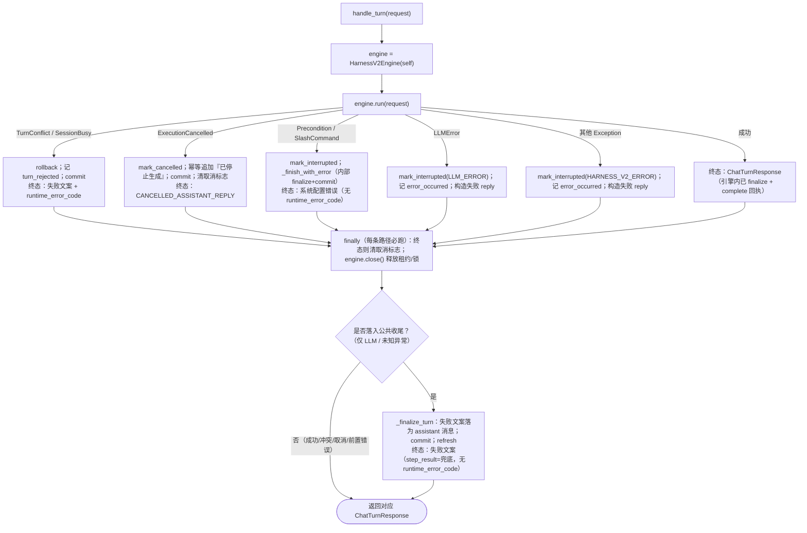
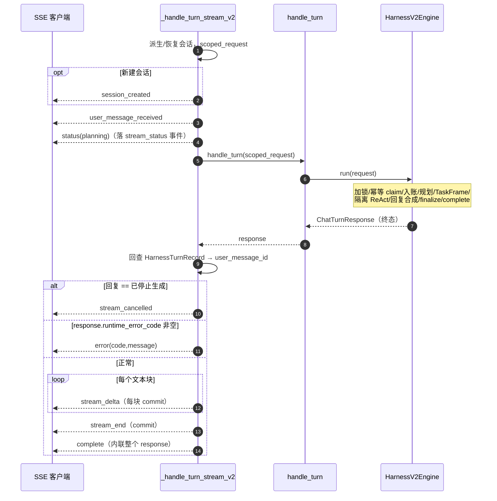

# `handle_turn` 与 `handle_turn_stream` 实现分析

> 分析对象：`backend/app/core/agent_loop.py`
> - `AgentLoop.handle_turn`：`:166-296`
> - `AgentLoop.handle_turn_stream` / `_handle_turn_stream_v2`：`:298-441`
>
> 关联对象：`backend/app/core/harness_v2_engine.py`（`HarnessV2Engine.run :208-770`）、`harness_turn_store.py`（幂等回执）、`turn_finalizer` / `_finalize_turn`
> 分析日期：2026-09-15
> 互补文档：[agent_loop.py 源码分析](agent_loop_analysis.md)、[HarnessV2Engine 代码走读](harness_v2_engine_walkthrough.md)、[Harness v2 执行引擎分析](harness_v2_analysis.md)、[Chat Stream API](chat-stream-api.md)

---

## 0. 一句话结论

`handle_turn` 是一轮对话（turn）的**同步执行门面 + 异常兜底边界**：成功时整段主流程由 `HarnessV2Engine.run()` 完成并**直接 return**；只有引擎抛出异常时，控制权才回到本方法，被翻译成统一的失败/取消 `ChatTurnResponse`。

`handle_turn_stream` 并**不是**与 `handle_turn` 并列的另一套执行实现，而是它的**生成器外壳（decorator）**：先吐几个 SSE 引导事件，然后**同步调用 `self.handle_turn(...)`** 拿到终态响应，再把终态响应翻译成 SSE 事件序列。因此两者共享同一条执行主链路与全部异常/幂等/租约语义，差异只在「返回形态」与「事件序列」。

---

## 1. 角色定位与调用关系

### 1.1 谁调用谁

```
HTTP/SSE 路由  ──handle_turn_stream(generator)──►  _handle_turn_stream_v2
  (api/chat.py, public_api/runs.py,                  │
   scheduled_tasks, teams/wakeup)                    │ 先 yield 引导事件
                                                     ▼
                                              self.handle_turn(scoped_request)  ◄── 同步
                                                     │
非流式调用方 ──handle_turn(response)────────────────►┤
  (api/chat.py, general_skills, teams)               ▼
                                            HarnessV2Engine(self).run(request)
```

调用点（`grep handle_turn`）：

| 调用方 | 使用的入口 |
|---|---|
| `app/api/chat.py:1048`、`general_skills.py:791`、`teams.py:421` | 同步 `handle_turn` |
| `app/api/chat.py:1247`、`public_api/runs.py:208`、`scheduled_tasks/service.py:548`、`teams/wakeup.py:758` | 流式 `handle_turn_stream` |
| `app/channels/service_intake.py:1610` | `handle_turn` + 可选 `stream_sink`（渠道侧流式投递） |

### 1.2 关键设计：执行下沉、门面兜底

引入 Harness v2 后，真正的执行流水线（加锁 → 幂等领取 → 入账 → 规划 → TaskFrame 调度 → 隔离 ReAct → 收尾落账）全部在 `HarnessV2Engine.run()` 内。`AgentLoop` 主要保留三件事：

1. **入口适配**：同步响应 vs SSE 事件流；
2. **异常归一化**：把引擎层各类异常翻译成统一响应/错误事件；
3. **收尾与 owner 回调**：引擎通过 `self.owner`（即 `AgentLoop`）反向调用 `_append_message`、`_finalize_turn`、`_get_request_model` 等大量方法——两者是**双向协作**。

---

## 2. `handle_turn` 逐段走读

签名与初始局部状态（`:166-170`）：

```python
def handle_turn(self, request: ChatTurnRequest) -> ChatTurnResponse:
    engine = HarnessV2Engine(self)
    chat_session: ChatSession | None = None
    user_message_id: str | None = None
    step_result = StepAgentResult(action="reply")
```

- 每轮新建一个 `HarnessV2Engine`（一次性对象，不跨 turn 复用）。
- `step_result` 是**兜底默认值**（`action="reply"`），只用于异常响应；成功路径的 `step_result` 由引擎内部用 `last_step_result` 构造响应。

### 2.1 主流程：成功即返回（`:171-172`）

```python
try:
    return engine.run(request)
```

**成功时函数在此直接返回**，后续的所有 `except`、`finally` 中的清理仍会执行（`finally` 必跑），但 `finally` 之后的「公共收尾段」`:276-296` **不会**执行。正常落账（assistant 消息、事件、turn 回执 `complete`）已全部在 `engine.run()` 内部完成。

`engine.run()` 内部主链路（详见 [HarnessV2Engine 走读](harness_v2_engine_walkthrough.md)）：

1. `_with_recoverable_first_session`：首轮无 `session_id` 但有 `client_turn_id` 时，由 `tenant+user+client_turn_id` 派生确定性 session id（幂等恢复）。
2. 进程内会话锁 `acquire_harness_session` + DB 会话租约 `session_leases.acquire`。
3. `turn_store.claim`：以 `client_turn_id` 为键的**精确一次回执**。
   - 已 `completed` → 直接返回存档响应（**replay**，`:223-224`）；
   - 同 id 不同请求摘要 / 仍在执行 / 已终结 → 抛 `HarnessTurnConflict`。
4. `_mark_session_running` → 追加 user 消息 → `bind_user_message` → 记录 `user_message_received`。
5. 斜杠指令解析、上下文注入、模型配置、SOP 投影、记忆召回、会话上下文构建。
6. `TurnPlanner.plan`（或斜杠计划）→ 槽位水合 → 记 `turn_plan_created` / `router_decision_created` → 团队帧派发。
7. `persist_plan` 持久化 TaskFrame → 依赖排序 → 逐帧 `_run_frame`（受 `max_actions` 预算、依赖、取消、租约栅栏约束）。
8. 恢复可见帧、会话投影、引用/产物聚合、回复合成（`ResponseGenerator`，有 `stream_sink` 时走流式生成）。
9. 取消栅栏 `_raise_if_cancelled` → `turn_store.begin_completion`（抢占「正常终态」发布权）→ `owner._finalize_turn`（追加 assistant 消息、引用规整、会话标题/摘要、渠道投递、事件）→ commit。
10. `turn_store.complete(turn_record, response)`：把终态响应写入回执，供后续 replay。
11. 返回 `ChatTurnResponse`。

### 2.2 异常处理矩阵（`:173-262`）

异常的排列顺序即优先级（更具体的在前）。每条分支都先尝试 `chat_session = engine.session`，若引擎尚未建立会话则回退 `self._get_or_create_session(request)`，保证**即使在极早阶段失败也能给出带 session 的响应**。

| # | 捕获异常 | 引擎状态处理 | DB / 事件 | 终态响应 | 是否在本方法 return |
|---|---|---|---|---|---|
| 1 | `HarnessTurnConflict` / `HarnessSessionBusy` | 读 `engine.session` | `rollback` → 记 `turn_rejected` → `commit` | `runtime_error_code = HARNESS_SESSION_BUSY` 或 `HARNESS_TURN_CONFLICT`；文案「并发或重复请求已阻止」 | **是**（`:193`） |
| 2 | `HarnessExecutionCancelled` | `engine.mark_cancelled()` | 追加「已停止生成」assistant 消息（去重）→ commit → `clear_chat_turn_cancelled` | `reply = "已停止生成"`（`CANCELLED_ASSISTANT_REPLY`），无错误码 | **是**（`:221`） |
| 3 | `AgentLoopPreconditionError` / `SlashCommandError` | `engine.mark_interrupted(exc.code, exc.message)` | 委托 `_finish_with_error`（其内部记 `error_occurred`、finalize、commit） | 文案「系统配置错误」，携带 `exc.code`（但**不写** `runtime_error_code`） | **是**（经 `_finish_with_error`，`:231`） |
| 4 | `LLMError` | `mark_interrupted("LLM_ERROR", …)` | 记 `error_occurred{LLM_ERROR}` | `format_runtime_failure_reply("模型调用失败", …, model_failure_suggestion)` | 否，落入公共收尾 |
| 5 | 兜底 `Exception` | `mark_interrupted("HARNESS_V2_ERROR", …)` | 记 `error_occurred{HARNESS_V2_ERROR}` | 「Harness v2 执行出错，请查看执行记录或服务日志」 | 否，落入公共收尾 |

要点：

- **分支 1（并发/重复）是唯一显式 `self.db.rollback()` 的分支**。因为冲突通常发生在 claim/锁阶段，当前事务可能是脏的，必须先回滚再重建会话。
- **分支 2（取消）**调用 `engine.mark_cancelled()`（`harness_v2_engine.py:1259`）：先 `rollback`，把 source turn 名下 running 的 run/frame 终结为 `cancelled`，再 `turn_store.finish_with_error(status="cancelled")`。随后本方法用 `_persist_cancelled_assistant_message` 幂等地补一条「已停止生成」，并清理取消标志位（Redis/内存）。
- **分支 3（前置/斜杠错误）**不复用公共收尾，而是走 `_finish_with_error`（`:1606`）：它独立做 finalize+commit，并返回**不带** `step_result`、**不带** `runtime_error_code` 的响应。
- **分支 4/5** 只负责「标记中断 + 记录事件 + 构造失败 reply 字符串」，然后**穿透**到 `finally` 与公共收尾，由 `_finalize_turn` 把失败文案作为一条 assistant 消息落库。

### 2.3 `finally`：终结后清理取消标志 + 释放引擎（`:263-274`）

```python
finally:
    terminal_record = getattr(engine, "turn_record", None)
    terminal_session = getattr(engine, "session", None)
    if (terminal_record is not None
        and terminal_session is not None
        and terminal_record.status in {"completed", "failed", "cancelled"}):
        for turn_id in (engine.user_message_id, request.client_turn_id):
            if turn_id:
                clear_chat_turn_cancelled(terminal_session.id, turn_id)
    engine.close()
```

- 无论成功/失败/取消，`engine.close()` 都执行：释放 DB 会话租约、释放进程内会话锁（`harness_v2_engine.py:772`）。
- 仅当 turn 回执已到达**终态**时清理取消标志。成功路径回执已在 `run()` 内被 `complete` 置为 `completed`，因此成功返回前这里也会清一次标志（与取消分支的清理互补、幂等）。
- 使用 `getattr(..., None)` 是防御性写法：即使 `HarnessV2Engine.__init__` 本身异常也能安全进入 `finally`。

### 2.4 公共收尾段（`:276-296`，仅分支 4/5 到达）

```python
reply = self._finalize_turn(chat_session, request.tenant_id, reply, step_result,
                            request.message, user_message_id=user_message_id,
                            assistant_metadata_override=(...message_visibility...))
self.db.commit()
self.db.refresh(chat_session)
return ChatTurnResponse(reply=reply, session_id=chat_session.id,
                        step_result=step_result,
                        session_state=public_session(chat_session))
```

- `_finalize_turn`（`:1630`）：更新会话时间/状态、引用规整与压缩、会话标题兜底、`summary = 最近回复：…`、**追加 assistant 消息**、在非流式投递成功时 `stage_channel_delivery`（渠道出站暂存）、记录 `assistant_message_created` 与 `session_state_changed`。
- 注意：此路径返回的 `ChatTurnResponse` **没有** `runtime_error_code` 字段——即使 `reply` 是 LLM/兜底失败文案。结构化错误码只通过事件 `error_occurred` 留存，**响应对象上不回传**（与分支 1 形成对比，见 §5 差异点 D5）。

### 2.5 `handle_turn` 全流程



> 说明：`finally` 在每条返回路径上都必然执行（图中汇合为 `FIN`）。只有 LLM 错误与兜底未知错误会在 `finally` 之后再走一次公共收尾 `_finalize_turn`；其余四类在 `except` 分支内即已构造并返回终态响应。

---

## 3. `handle_turn_stream` 逐段走读

`handle_turn_stream`（`:298`）只是一行转发：

```python
def handle_turn_stream(self, request):
    yield from self._handle_turn_stream_v2(request)
```

真正逻辑在 `_handle_turn_stream_v2`（`:301-441`），它是一个**生成器**，产出 `{"event": kind, "data": {...}}` 形态的 SSE 帧。

### 3.1 阶段划分

**阶段 A — 会话预备与引导事件（`:302-344`，发生在调用 `handle_turn` 之前）**

1. `_with_recoverable_first_session(request)`：派生首轮确定性 session。
2. 先读一次 `existing_session` 以判断是否「新建」，再 `get_or_create_harness_session`（处理并发 PK 竞争、tenant/user/agent 一致性校验）。
3. `scoped_request = request.model_copy(update={"session_id": chat_session.id})`：把解析出的 session 钉进请求。
4. 依次 yield：
   - 若新建会话：`session_created`（含 `sessionId / turn_id / client_turn_id / execution_engine=harness_v2`）；
   - `user_message_received`（`_turn_payload` 注入 `user_message_id/turn_id`，此处用 `client_turn_id` 作为初始 `initial_turn_id`）；
   - `status: planning`「正在规划本轮任务」（`_stream_status` 在有 turn_id 时会落一条 `stream_status` 事件并 commit）。

**阶段 B — 同步执行整轮（`:345`）**

```python
response = self.handle_turn(scoped_request)
```

这是流式与非流式**共用执行链路**的关键：所有规划、工具、SOP 推进、收尾落库都在这一次同步调用内完成。也就是说：

- 流式外壳的「规划中」状态发出后，**会阻塞**直到整轮执行结束；HTTP 层在这期间除引导事件外收不到中间增量。
- 真正的「逐 token 流式」只有在 `AgentLoop` 注入了 `stream_sink`（渠道入站路径）时，才在 `engine.run` 内部通过 `stream_sink.on_delta` 推送；HTTP SSE 这条路径默认 `stream_sink=None`，模型回复是**整段生成后再切块**（见阶段 D）。

**阶段 C — 回查 user 消息与 turn_id（`:346-394`）**

执行后重新 `db.get` 会话（拿到 commit 后的最新状态）。然后解析 `user_message_id`：

- 优先用 `client_turn_id` 查 `HarnessTurnRecord`，取其 `user_message_id` 并校验 tenant/session/role；
- 若无 `client_turn_id`，退化为「该会话最近一条 user 消息」；
- 该 `user_message_id` 用于把后续 SSE 帧关联到正确的 turn。

随后处理两种**提前终结**：

- `response.reply == CANCELLED_ASSISTANT_REPLY` → yield `stream_cancelled`，**return**；
- `response.runtime_error_code` 非空 → yield `error{code,message}`，**return**。

**阶段 D — 正常切块与收尾帧（`:410-441`）**

- 用 `self.response_generator.chunk_text(response.reply)` 把**已落库的整段回复**切成 `stream_delta` 帧，**每块 commit 一次**后 yield；
- yield `stream_end`（commit）；
- yield `complete`，其 data 直接内联 `response.model_dump(mode="json")` + `execution_engine`。

### 3.2 SSE 事件序列



`_stream_event`（`:465`）会对一组**需持久化**的事件类型（`stream_delta`、`stream_end`、`step_result`、`tool_result`、`knowledge_result` 等，且 payload 带 `turn_id/user_message_id`）写一条事件记录并 commit；`session_created/user_message_received/status/complete/error/stream_cancelled` 不在该持久化集合内（部分由 `_stream_status` 或路由层另行落库）。

---

## 4. 两个入口的共性

1. **同一执行内核**：流式最终调用 `handle_turn`，二者共享加锁、会话租约、turn 幂等回执、TaskFrame 调度、取消协作、`_finalize_turn` 落账等全部语义。
2. **同一幂等域**：都经 `_with_recoverable_first_session` + `HarnessTurnStore.claim`。重复 `client_turn_id` 在两条入口上都会命中 replay/冲突逻辑。
3. **同一终态来源**：流式不自己判断成功失败，而是读 `handle_turn` 返回的 `reply` 与 `runtime_error_code` 决定尾部事件。
4. **同一取消标志**：取消经 `HarnessExecutionCancelled` → `mark_cancelled` → 「已停止生成」消息；流式靠回复文本识别，非流式直接返回该常量。
5. **引擎一次性**：每次入口调用都新建 `HarnessV2Engine`，由 `finally`/生成器结束时释放锁与租约。

---

## 5. 差异点逐项对比

| 维度 | `handle_turn` | `handle_turn_stream` |
|---|---|---|
| 返回类型 | `ChatTurnResponse`（一次性） | `Iterator[dict]`（多帧 SSE） |
| 执行方式 | 直接 `engine.run` | 先发引导帧，再**同步**调 `handle_turn` |
| 会话创建可见性 | 内部创建，仅在终态 `session_state` 体现 | 额外提前发 `session_created` 帧 |
| 进度反馈 | 无（仅注入 `stream_sink` 时由引擎内部推送渠道流） | 引导 `status(planning)` + 终态切块 `stream_delta/stream_end` |
| 增量来源 | 整段 | 默认也是「整段生成后 `chunk_text` 切块」；非真正 token 流（除非引擎内 `stream_sink` 生效） |
| 取消如何上报 | 直接返回 `reply="已停止生成"` | 由 `response.reply` 文本判定后发 `stream_cancelled` |
| 错误如何上报 | 冲突类填 `runtime_error_code`；其余仅事件+失败文案 | 仅当 `runtime_error_code` 非空才发 `error` 帧 |
| 终态帧 | `ChatTurnResponse` | `complete`（内联 `response.model_dump`） |
| 提交节奏 | 引擎/收尾内部按阶段 commit | 额外在每个 `stream_delta`、`stream_end` 后 commit |
| 异常处理 | 拥有完整 try/except 矩阵 | **自身不写 try/except**，完全继承 `handle_turn`；其结果只映射为取消/错误/正常三类尾部 |
| 调用前副作用 | 无 | 调用前已发事件、可能落 `stream_status` 并 commit |
| 典型调用方 | 非流式 HTTP、内部服务、团队、技能测试 | SSE 路由、定时任务唤醒、团队唤醒、public runs |

### 5.1 值得专门记录的几个语义细节

**D1 —「流式」并非端到端 token 流。** HTTP SSE 路径下，`handle_turn_stream` 在发出 `planning` 后用一次同步 `handle_turn` 跑完整个 turn，再把成品回复切块。真正的模型 token 流式只存在于注入 `stream_sink` 的渠道入站链路（`engine.run` 内 `generate_stream` / `chunk_text(...).on_delta`）。前端在长任务执行期间看到的主要是前置 `planning` 与终态批量 `delta`。

**D2 — turn_id 的两段来源。** 引导阶段 `initial_turn_id = client_turn_id`；执行后再通过 `HarnessTurnRecord.user_message_id` 回查权威 id（`resolved_turn_id = user_message_id or initial_turn_id`）。这样保证无 `client_turn_id` 或回放场景下，后续 `stream_delta/stream_end/complete` 仍能挂到正确的 turn。

**D3 — 提前 return 的两种终态。** `stream_cancelled` 与 `error` 都**不**产生 `stream_delta/stream_end/complete`。调用方/前端需把这两类事件视作终结帧（路由层 `chat.py:1258` 正是把它们计入 `worker_terminal["seen"]`）。

**D4 — 失败 reply 会被二次持久化的保护。** LLM/兜底异常穿透到公共收尾，由 `_finalize_turn` 追加失败 assistant 消息；而 `engine.run` 在异常前若已走到 `begin_completion` 但未 `complete`，`mark_interrupted` 会把回执置 `failed`，使旧执行权失效，避免同一 turn 出现两条终态 assistant 消息（引擎注释「Cancellation and normal projection compete for this durable receipt」即描述这一竞争）。

**D5 — 结构化错误码在流式上的覆盖不完整（潜在不一致）。**
- 冲突分支（异常矩阵 #1）返回的 `ChatTurnResponse` 带 `runtime_error_code`，因此流式会发 `error` 帧；
- 但 LLM 错误（#4）、兜底未知错误（#5）、前置/斜杠错误（#3）返回的响应**不带** `runtime_error_code`，流式会把它们当作**正常回复**：对失败文案逐个发 `stream_delta`、再发 `stream_end`、`complete`，而**不发 `error` 帧**。

也就是说：同样是「执行失败」，冲突在 SSE 上表现为 `error`，而模型故障/未知故障在 SSE 上表现为「正常文本流（内容是失败提示）」。若前端依赖 `error` 事件做错误态 UI，后者不会被识别为错误。非流式调用方则只能从事件 `error_occurred`、而无法从 `ChatTurnResponse.runtime_error_code` 读到 LLM/未知错误码。这是当前实现中最需要留意的一个契约缺口。

**D6 — 引导事件早于执行、无法撤回。** `planning` 等帧在 `handle_turn` 之前已 yield；若 `handle_turn` 最终因冲突/故障返回，这些引导帧已经发出。协议依赖尾部的 `error/stream_cancelled` 来纠正语义，客户端不能仅凭 `user_message_received/planning` 认定执行已开始成功。

---

## 6. 事务、锁、幂等与取消的协作切面

- **进程内互斥**：`acquire_harness_session(session_id)`，同会话并发执行第二个会抛 `HarnessSessionBusy`（异常矩阵 #1）。
- **跨进程租约/栅栏**：`HarnessSessionLeaseStore` + TaskFrame 的 `lease_owner/attempt_no`，丢失租约抛 `HarnessSessionLeaseLost`/`HarnessExecutionFenced`，最终落入兜底异常（#5）。
- **turn 幂等回执**：`HarnessTurnStore` 以 `(tenant,session,client_turn_id)` 唯一，请求体做 sha256 摘要防同 id 异请求；`completed` 直接 replay，`started/finalizing` 拒绝重复，终态不可逆。
- **取消协作**：执行内多处 `_raise_if_cancelled` 协作式检查；终态由 `turn_store` 的 `begin_completion`/`cancel`/`finish_with_error` 用**条件更新（fenced update）**仲裁，保证正常投影与取消只有一方能发布终态 assistant 消息。
- **锁/租约释放**：`handle_turn` 的 `finally` 必跑 `engine.close()`；流式因同步调用 `handle_turn`，其 `finally` 在阶段 B 内即已完成释放，随后流式只做只读回查与事件输出。

---

## 7. 小结

- `handle_turn` = **执行门面 + 异常翻译器 + 兜底落账**；成功短路返回引擎响应，异常按「并发/取消/前置/模型/未知」分级处理，`finally` 统一释放并清取消标志。
- `handle_turn_stream` = **SSE 适配外壳**，不重复实现执行，而是「引导帧 → 同步 `handle_turn` → 终态翻译帧」，保证流式与非流式在幂等、锁、取消、落账上完全一致。
- 主要改进关注点集中在 **D5（错误码在两条入口/响应对象上的不对称）** 与 **D1（SSE 非端到端 token 流）**：若要让前端可靠区分所有失败态，建议让 LLM/兜底/前置分支也在 `ChatTurnResponse.runtime_error_code` 上回传结构化错误码，流式即可统一经 `error` 帧上报。
