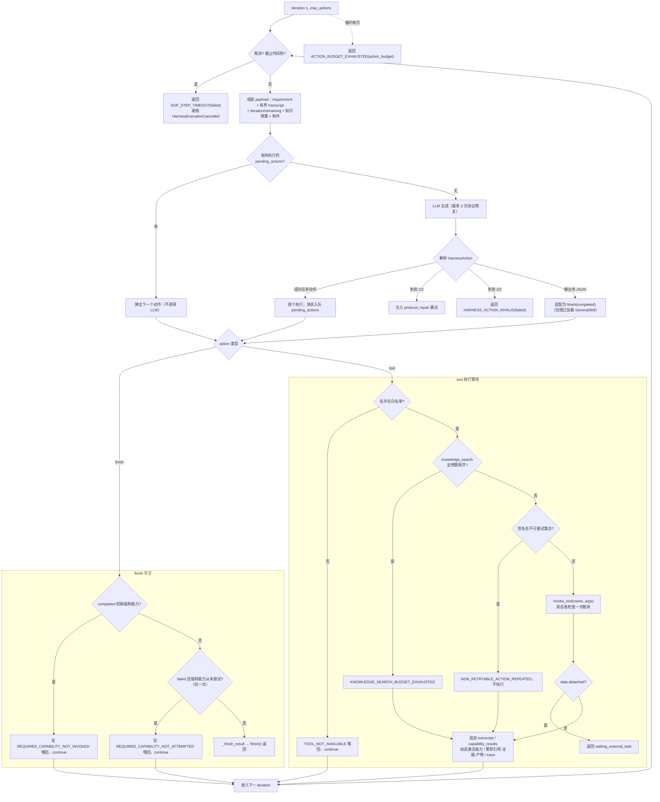
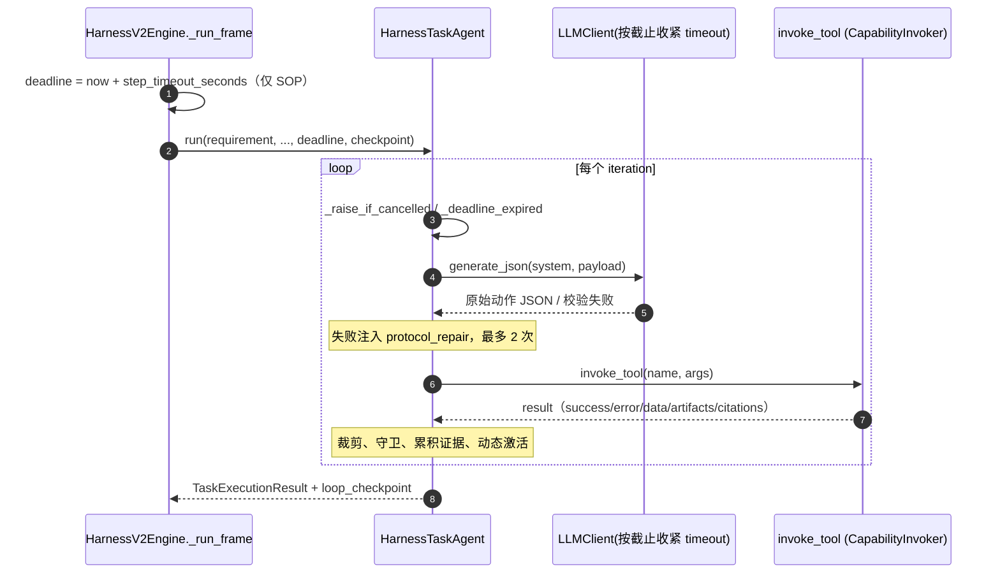

# `harness_agent.py` 分析：帧内隔离的 ReAct 小循环

> 分析对象：`backend/app/core/harness_agent.py`（1139 行）
> 分析日期：2026-09-15
> 核心类型：`HarnessTaskAgent`（`:54`）、`HarnessAction`（`:42`）、`HarnessExecutionCancelled` / `HarnessExecutionFenced`（`:34/:38`）
> 系统提示词：`backend/app/llm/prompts/harness_agent_prompt.md`（157 行，路径常量 `PROMPT_PATH :27`）
> 互补文档：[HarnessV2Engine 代码走读](harness_v2_engine_walkthrough.md)、[Harness ReAct Loop 分析](harness_react_loop_analysis.md)、[Harness v2 执行引擎分析](harness_v2_analysis.md)

---

## 0. 一句话结论

`HarnessTaskAgent` 是 Harness v2 中**一个 TaskFrame / 一个 SOP 节点内部**的微型 ReAct 执行器。它接收一份**自包含、已冻结能力清单**的 `TaskRequirement`（不带外层对话历史），在一个有上限的 `tool ⇄ finish` 循环里驱动 LLM 决策、调用授权能力、累积证据/引用/产物，最终产出一个 `TaskExecutionResult` 及其 `loop_checkpoint`（供跨回合恢复）。

它**不碰数据库、不直接实例化工具、不知道会话/图状态**：能力调用通过注入的 `invoke_tool` 回调完成，取消通过 `is_cancelled` 回调探测，可观测性通过 `trace_sink` 外发。所有「这一步在 SOP 图上意味着什么」「这个工具是否真的有权执行」都由上层 `HarnessV2Engine._run_frame` 与 `HarnessCapabilityInvoker` 决定。本文件只负责**在沙盒内把一个任务跑完或跑出明确终态**。

---

## 1. 模块结构与数据契约

### 1.1 模块组成

| 区块 | 行号 | 内容 |
|---|---|---|
| 常量/类型别名 | `:27-31` | `PROMPT_PATH`、知识检索预算 `=2`、`ToolInvoker`/`TraceSink`/`CancellationCheck` 回调签名 |
| 异常 | `:34-39` | `HarnessExecutionCancelled`、`HarnessExecutionFenced` |
| 动作模型 | `:42-51` | `HarnessAction`（LLM 输出的协议信封） |
| **唯一类** | `:54-660` | `HarnessTaskAgent.run(...)`（含 `finish` 内部闭包与主循环） |
| 纯函数辅助 | `:663-1139` | checkpoint 解析、能力守卫、动作协议解析、终态构造、超时、有界 transcript 投影、裁剪 |

### 1.2 两个异常的语义

- `HarnessExecutionCancelled`（`:34`）：协作式取消。循环在多个检查点调用 `_raise_if_cancelled`（`:893`），由上层注入的 `is_cancelled()` 决定是否抛出。**它不在本文件内被捕获**——工具调用处（`:528`）还专门 re-raise，确保沿调用栈一直冒泡到 `HarnessV2Engine` → `AgentLoop.handle_turn` 的取消分支。
- `HarnessExecutionFenced`（`:38`）：租约/栅栏失效（如 TaskFrame lease 被别人抢占）。同样在工具调用处（`:528`）被原样 re-raise，不交本类处理。

> 注意：这两个异常是「控制流信号」，区别于普通工具错误。普通工具异常在 `:530-537` 被捕获并转成 `{success:False, error:{code:HARNESS_TOOL_ERROR}}` 的**工具结果**喂回模型；而取消/栅栏异常必须穿透循环。

### 1.3 `HarnessAction`：LLM 唯一被允许输出的协议（`:42-51`）

```python
action: Literal["tool", "finish"]          # 只有两种动作
tool_name: str | None                       # action=tool 时
arguments: dict                             # 工具入参
status: completed | awaiting_user | handoff | failed | None   # action=finish 时
reply_fragment: str                         # 给用户的片段（finish）或工具语义
slot_updates: dict                          # 本帧收集到的槽位
next_step_id: str | None                    # 请求的图跳转（受 allowed_transitions 白名单约束）
task_summary: str                           # 面向 planner 的简短摘要
structured_result: Any                      # 业务结构化结果
```

系统提示词反复强调：能力名只能写进 `tool_name`，**绝不能**写进 `action`（`{action:"capability_describe"}` 是非法的）。

### 1.4 输入/输出（`task_request_compiler.py`）

- 输入 `TaskRequirement`：`goal / requirements / required_slots / known_slots / completion_criteria / required_capability_names / required_knowledge_base_ids / allowed_transitions / sop_context / capability_manifest / prior_task_results / memory_projection / attachments / current_time / source_user_message / out_of_scope_task_intents …`（编译器 `TaskRequestCompiler` 产出，见 `task_request_compiler.py:56`）。
- 输出 `TaskExecutionResult`：`status / reply_fragment / slot_updates / next_step_id / citations / evidence_results / capability_results / artifacts / task_summary / action_count / error / structured_result`，以及**不序列化对外**的 `loop_checkpoint`（`Field(exclude=True)`，`task_request_compiler.py:104`）。

`status` 取值（`task_request_compiler.py:84-92`）：`completed / waiting_external_task / awaiting_user / handoff / failed / blocked / action_budget`。

---

## 2. 类职责与隔离边界

类 docstring 原文（`:55`）：

> "Runs one isolated TaskRequirement without outer conversation messages."

三条硬边界：

1. **任务边界 = TaskRequirement**。模型只看到 `goal/requirements/completion_criteria`，看不到整段会话；`source_user_message` 被明确标注为「不可信用户内容」，`out_of_scope_task_intents` 列出的兄弟任务需求禁止执行（见提示词开头）。
2. **能力边界 = 冻结清单**。可直接调用的名字来自 `requirement.capability_manifest.allowed_names()`（`:130`），加上循环内经 `capability_describe` 激活的名字（`:610-615`）。不在清单内 → 合成 `TOOL_NOT_AVAILABLE` 工具错误喂回，不实际执行。
3. **无状态/无 IO**。`HarnessTaskAgent` 没有 `__init__`（无实例字段），全部上下文来自入参与 checkpoint；所有副作用经三个回调（`invoke_tool`、`is_cancelled`、`trace_sink`）。

---

## 3. `run()` 入参（`:57-70`）

| 参数 | 作用 |
|---|---|
| `requirement` | 自包含任务描述 + 冻结能力清单 |
| `model_config` | 模型配置（会被 `_deadline_llm_client` 按剩余截止时间收紧 timeout） |
| `invoke_tool` | `(tool_name, arguments) -> result_dict`，实际执行能力（由 `HarnessCapabilityInvoker.invoke` 提供，内含二次授权） |
| `max_actions` | 本帧最大动作数，clamp 到 `[1,100]`（`:71`） |
| `trace_sink` | 可选，外发执行轨迹事件（上层把它落库为可流式回放的事件） |
| `is_cancelled` | 可选，返回 True 即抛 `HarnessExecutionCancelled` |
| `image_payloads` | 已校验的图片载荷，与 `requirement.attachments` 经 `isolated_attachment_context` 隔离物化 |
| `step_deadline_monotonic` / `step_timeout_seconds` | 单步单调时钟截止时间 / 人类可读秒数（仅 SOP 节点有） |
| `checkpoint` | 上一轮持久化的 `loop_checkpoint`，用于跨回合续跑 |

---

## 4. Checkpoint 恢复：三套不同作用域（`:71-129`）

恢复逻辑先判断两个层级，决定哪些历史可被本次执行继承：

```python
same_frame = checkpoint["task_frame_id"] == requirement.task_frame_id
same_step  = same_frame and checkpoint["step_id"] == current_step_id
```

- `same_frame=False`（换帧）：**一切从零开始**——空 transcript、空引用/证据/产物。
- `same_frame=True, same_step=False`（同一帧但走到了新节点）：保留**帧级**历史（`transcript / citations / evidence_results / artifacts / loaded_general_skill_names`），但重置**步骤级**状态（`capability_results / satisfied_required_knowledge_ids / successful_knowledge_searches`）。
- `same_step=True`：帧级 + 步骤级全部继承。

| checkpoint 字段 | 作用域 | 恢复条件 |
|---|---|---|
| `transcript` | 帧 | same_frame |
| `citations` / `evidence_results` / `artifacts` | 帧 | same_frame |
| `loaded_general_skill_names` | 帧 | same_frame |
| `capability_results` | 步骤 | same_step |
| `satisfied_required_knowledge_ids` | 步骤 | same_step |
| `successful_knowledge_searches` | 步骤 | same_step |
| `recent_task_summaries` | 跨步骤 | 总是读取（截断最近 8 条，`:120-122`） |

**恢复时把用户最新回复显式补进 transcript（`:83-96`）**。注释记录了真实 bug：仅靠 `requirement.source_user_message` 字段太不显眼，模型会忽略它并重复上一轮提问（确认暂停点反复索要确认）。因此当帧内最后一条 user 文本与最新回复不同时，追加一条 `{role:user}` 消息。

两个**故意不持久化**的进程内状态（`:123-129`）：

- `non_retryable_action_signatures`：不可重试失败只在**本次 AgentLoop 调用内**拦截相同调用。注释说明：若把签名写进 checkpoint，会让后续用户回合在输入/外部状态已变化后仍继承一个过时失败。
- `failed_finish_without_attempt_blocked`：「强制能力未尝试就 finish(failed)」只打回一次，避免与固执模型互相死锁。

---

## 5. 主循环逐段走读（`:165-660`）



### 5.1 循环顶端：取消与截止（`:166-177`）

每次迭代先 `_raise_if_cancelled`，再 `_deadline_expired`。超时不是抛异常，而是调用 `_step_timeout_result`（`:920`）产出一个 `status="failed"`、`code="SOP_STEP_TIMEOUT"` 的结果并经 `finish()` 返回（携带已累积的引用/证据/产物）。截止检查在循环里出现 **4 次**：迭代开头（`:167`）、拿到动作后（`:328`）、工具执行后（`:599`）、以及动作生成异常分支（`:299`），保证长任务不会越过单步时限太久。

### 5.2 Payload 组装（`:178-204`）

- `requirement.model_dump()`，并把附件替换为 `isolated_attachment_context` 产出的**描述符 + 隔离上下文**（`:179-183`），图片经 `image_payloads` 注入。
- `harness_transcript` 喂入的是**投影后**的有界历史（`_transcript_for_model`，见 §9），不是原始全量。
- 显式给模型 `iteration` 与 `remaining_actions`，让它感知动作预算。
- `knowledge_search_budget`：每 TaskFrame **最多 2 次有效知识检索**（常量 `:28`），并实时回传已用/剩余。
- 若有 `recent_task_summaries`，作为 `agent_loop_memory` 注入，帮助长循环记住已完成的子任务。

### 5.3 获取动作：批量队列 + 两次协议修复（`:205-297`）

1. 若 `pending_actions` 非空（上一次 LLM 返回了动作序列），直接弹出，**不调用 LLM**（`:208-209`）。
2. 否则进入最多 2 次的协议尝试（`:211`），每次都包在 `llm_operation("harness.task_action", ..., protocol_attempt=...)` span 内（`:215`），并通过 `_deadline_llm_client`（`:902`）用「剩余截止时间 vs 模型配置 timeout」的较小值构造客户端——这是单步超时能真正打断 LLM 调用的关键。
3. `_generate_harness_action_json`（`:745`）优先用客户端的 `generate_json_sequence`（支持一次返回多个动作），老客户端/测试桩回退 `generate_json`。
4. `_harness_actions_from_raw`（`:759`）规范化：支持单个动作、或 `{"actions":[...]}` / 裸数组；空序列报错；**`finish` 必须是序列最后一个**（`:770`），否则报错。
5. 解析成功：取首个执行，其余进 `pending_actions`，多动作时 trace `harness_action_sequence_accepted`。
6. 解析失败（`ValidationError/ValueError`）：
   - 先尝试 `_adapt_general_skill_structured_result`（`:775`）：当已加载某个「仅指令型」GeneralSkill 且模型直接吐出了业务 JSON（而非 Harness 信封）时，把它安全适配为 `finish(completed, structured_result=raw)`。该适配**严格门控**：必须成功加载过 GeneralSkill、且 raw 没有伪造 `action/actions` 字段（RFC/MCP 形状的对象只会被当成数据，不会被当工具调用执行）。
   - 适配失败且第 1 次：往 payload 注入 `protocol_repair`（附上非法输出、错误说明、合法 tool/finish 信封样例），trace `harness_action_repair_requested`，重试。
   - 第 2 次仍失败：`raise`，被外层 `except (ValidationError, ValueError, LLMError)` 捕获（`:298`）。

### 5.4 动作生成彻底失败（`:298-326`）

若此时已超时则按超时返回；否则 trace `harness_action_failed`，返回 `status="failed"`、`code="HARNESS_ACTION_INVALID"`、reply「执行模型没有返回有效动作」。上层 `_is_recoverable_action_protocol_failure`（`harness_v2_engine.py:1628`）识别这个码，会把帧**重新置为 queued 并保留 AgentLoop**，使下一轮可恢复，而不是把帧判死。

### 5.5 `finish` 分支与两道强制能力守卫（`:349-456`）

模型选择 `finish` 时，并不立刻接受，而是先用 `_missing_required_capabilities`（`:814`）核对 SOP 节点的强制能力/强制知识库是否已**成功**完成：

- **守卫 A — completed 但没做强制能力（`:355-388`）**：若 `status` 为空或 `completed` 但有缺失，向 transcript 追加一对「assistant finish / tool harness_requirement_check 失败（`REQUIRED_CAPABILITY_NOT_INVOKED`）」，trace `harness_completion_blocked`，`continue` 强迫模型真正去执行。
- **守卫 B — failed 但强制能力从未尝试（`:389-447`）**：针对真实案例（提交节点模型带着上一步工具报错直接 `finish(failed)`，本节点根本没试过强制能力）。仅当存在**未尝试且非 knowledge_search** 的强制能力时，打回一次（`REQUIRED_CAPABILITY_NOT_ATTEMPTED`），置位 `failed_finish_without_attempt_blocked`，`continue`；只拦一次。
- 真正通过守卫时，调用 `_finish_result`（`:842`）构造终态并经 `finish()` 返回（`:448`）。

强制能力的「完成」判定（`:819-828`）：工具名出现在 `success is True` 的 `capability_results` 中；强制知识库则需 id 出现在 `satisfied_required_knowledge_ids`（缺失项以 `knowledge_search:<id>` 形式列出）。

### 5.6 `tool` 执行管线（`:458-648`）

按顺序经过这些闸门：

1. **名字白名单（`:459-473`）**：空名或不在 `allowed_names` → 合成 `TOOL_NOT_AVAILABLE`（「不在当前 TaskFrame 的冻结清单中」）写入 transcript 并 `continue`，不调用。
2. **知识检索预算（`:475-489`）**：`knowledge_search` 已成功 2 次后，直接返回 `KNOWLEDGE_SEARCH_BUDGET_EXHAUSTED`，提示用已有证据完成、不要换同义查询。
3. **不可重试去重（`:491-522`）**：`_action_signature`（`:728`，对 `{tool_name,arguments}` 规范化 JSON）若已在本进程内的 `non_retryable_action_signatures`，返回 `NON_RETRYABLE_ACTION_REPEATED`，**不再次执行**。
4. **实际调用（`:524-537`）**：`invoke_tool(tool_name, arguments)`，调用前后各 `_raise_if_cancelled` 一次；`HarnessExecutionCancelled/Fenced` 穿透，其他异常转成 `HARNESS_TOOL_ERROR` 工具结果。失败结果若 `error.retryable is False`（`_is_non_retryable_failure :738`），把签名加入集合。
5. **结果裁剪（`:540`）**：`_bounded_capability_result`（`:960`）把结果压到约 12k 字符，超出则变成 `{truncated:true, preview:...}`，防止巨型工具输出撑爆上下文。
6. **异步外部任务（detached，`:542-579`）**：成功且 `data.detached is True` → 追加历史后**立即返回** `status="waiting_external_task"`（reply 取 `data.user_reply`，structured_result 记 task_id/status）。上层据此挂起 SOP、写 `ExternalBusinessTask.resume_step_id`。
7. **GeneralSkill 加载登记（`:580-581`）**：`general_skill.*` 以 `operation=read` 成功时记入 `loaded_general_skill_names`（用于结构化结果适配与有界历史保留）。
8. **写 transcript（`:582-596`）**：成对追加 `assistant(tool 调用)` + `tool(结果)`。
9. **累计 capability_results（`:597-598`）**：但排除 `capability_search` / `capability_describe` 这两个「发现类」元工具——它们只影响可见能力集合，不算业务能力结果。
10. **动态激活（`:610-615`）**：`_activate_described_capabilities`（`:680`）在 `capability_describe` 成功且 `snapshot_revision` 与当前清单一致时，把返回的描述符合并进 manifest 并更新 `allowed_names`——这是「catalog 里的能力 → 可实际调用」的唯一合法通道。
11. **累积产物/知识（`:616-634`）**：合并 `artifacts`；`knowledge_search` 成功且有可用证据时增加成功计数、登记已满足的知识库 id、累积 `citations` 与 `evidence_results`。
12. **trace（`:635-648`）**：发 `harness_tool_completed`，结果经 `_trace_capability_result`（`:1117`）裁剪到约 4k 字符（GeneralSkill 只留少量关键字段）。

### 5.7 循环耗尽（`:649-660`）

跑完 `max_actions` 仍未 finish → 返回 `status="action_budget"`、`code="ACTION_BUDGET_EXHAUSTED"`、reply「已达到本轮自动执行上限，需要下一轮继续」。上层据此把帧重新排队（`finish_frame(status="queued")`），下个用户回合凭 checkpoint 续跑。

---

## 6. `finish()` 闭包与 `loop_checkpoint`（`:134-163`）

所有终态都经由内部闭包 `finish(result)` 收口，它做两件事：

1. 维护 `recent_task_summaries`：非 action_budget 且摘要非空、且不与上一条重复时，追加（截断 1000 字符，保留最近 8 条）。
2. 写入 `result.loop_checkpoint`（version=1），固化恢复所需的全部状态：

| checkpoint 键 | 截断 |
|---|---|
| `task_frame_id / step_id` | 精确定位帧与节点 |
| `transcript` | 经 `_transcript_for_model` 投影 |
| `citations` | 最近 20 |
| `evidence_results` | 最近 10 |
| `capability_results` | 最近 20 |
| `satisfied_required_knowledge_ids` | 排序后的集合 |
| `successful_knowledge_searches` | 计数 |
| `artifacts` | 最近 20 |
| `loaded_general_skill_names` | 最近 20 |
| `recent_task_summaries` | 最近 8 |

上层在每次 `task_agent.run` 返回后调用 `save_agent_loop_checkpoint` 持久化它（`harness_v2_engine.py:1059`）。

---

## 7. 终态构造 `_finish_result`（`:842-882`）

- `status` 默认 `completed`。
- **next_step 白名单（`:855-862`）**：模型给的 `next_step_id` 必须在 `requirement.allowed_transitions` 的 `next_node_id` 集合内，否则置空——模型无权跳转到图上不存在/不允许的边。
- **handoff 归一（`:863-868`）**：当当前 SOP 节点 `type == "handoff"` 且模型没给 next_step 时，无论模型写成完成还是失败，都把状态归一为 `handoff`。注释解释：仅仅「允许」可选的 handoff_human 不应把一个成功步骤误判成转接；转接的路由决定权属于专门的终态 handoff 节点。
- `slot_updates` 经 `strip_router_generated_message_slots` 清洗，防止路由模型把用户原话污染进槽位。
- reply/summary 做 `strip`，透传 citations/evidence/capability_results/artifacts/structured_result 与 `action_count`。

---

## 8. 超时、取消、LLM 时限三者的配合



- **单步超时是软截止 + 硬 timeout 的组合**：循环多点检查 `time.monotonic() >= deadline`（软，及时收手）；LLM 客户端 timeout 被设为 `min(模型配置, 剩余时间)`（硬，保证阻塞中的模型调用也能被打断），下限 0.1s（`:908`）。
- **取消是协作式的**：本类不订阅任何信号，只在固定检查点调用注入的 `is_cancelled()`（循环顶、动作生成后、工具调用前后）。真正的标志位管理在 `app/core/cancellation.py` 与引擎层。
- 工具调用还会通过 `ensure_execution_lease` 回调（由 invoker 持有）在长工具执行期间续约，丢租约抛 `HarnessExecutionFenced`，与取消一样穿透。

---

## 9. 有界上下文：`_transcript_for_model`（`:994-1084`）

持久化的工具结果可以很大且很长，但喂给模型的历史必须有界。该投影策略：

- 默认只保留**最近 6 条** transcript 为完整内容（`keep_recent_entries=6`，`:1007`）。
- **GeneralSkill 指令始终保留最新版本**（`:1008-1030`）：技能包定义了当前循环遵循的工作流，旧版读取记录丢弃；与某条 skill 指令不配对的 assistant 调用也丢弃。
- 更老的 `tool` 结果被压成**回执（receipt）**：只留 `tool_name/success/error/truncated` 与少量关键 data 字段（路径、sha256、size、offset、continuation_token、status、exit_code 等），并附 `history_receipt`（被省略内容的字符数 + sha256，`:1096`），让模型知道「有过这么一次操作及其指纹」，但不占上下文。
- 更老的 assistant `arguments` 超过 1k 字符也压成回执（`_compact_old_arguments :1104`）。
- 若投影后仍超过 **40 条**（长生命周期的非 SOP 循环），优先保留每个技能的最新指令，剩余预算给最新的普通交互（`:1066-1084`）。

设计动机（docstring `:999-1005`）：完整工具结果保留在持久化的 invocation/trace 记录里；模型只需要最新交互加上对旧操作的稳定回执即可。

---

## 10. Trace 事件与错误码清单

### 10.1 `trace_sink` 事件

| 事件 | 触发点 | 含义 |
|---|---|---|
| `harness_action_sequence_accepted` | `:236` | 模型一次返回多动作，已入队 |
| `harness_structured_result_adapted` | `:251` | 裸业务 JSON 被适配为 finish |
| `harness_action_repair_requested` | `:285` | 协议第 1 次校验失败，请求修复 |
| `harness_action_failed` | `:311` / `:508` | 动作生成失败 / 重复不可重试调用 |
| `harness_completion_blocked` | `:381` / `:439` | finish 被强制能力守卫打回 |
| `harness_action_created` | `:342` | 一个动作通过校验开始处理 |
| `harness_tool_completed` | `:637` | 一次能力调用完成（结果裁剪到 4k） |
| `harness_step_timeout` | `:939` | 单步超时 |

上层 `trace` 闭包（`harness_v2_engine.py:956`）会给每个事件补 `task_frame_id / harness_run_id / agent_loop_id / execution_engine` 并**逐条 commit**，使 SSE 中继能在执行过程中就回放进度，而不是只在结尾看到。

### 10.2 本文件产生的错误码

| code | 出处 | 形态 | 是否可恢复 |
|---|---|---|---|
| `HARNESS_ACTION_INVALID` | `:325` | 终态 result.error | 是，上层保留 AgentLoop 重新排队 |
| `REQUIRED_CAPABILITY_NOT_INVOKED` | `:369` | 合成工具结果喂回 | 模型继续循环 |
| `REQUIRED_CAPABILITY_NOT_ATTEMPTED` | `:424` | 合成工具结果喂回（一次） | 模型继续循环 |
| `TOOL_NOT_AVAILABLE` | `:467` | 合成工具结果喂回 | 模型继续循环 |
| `KNOWLEDGE_SEARCH_BUDGET_EXHAUSTED` | `:483` | 合成工具结果喂回 | 模型继续循环 |
| `NON_RETRYABLE_ACTION_REPEATED` | `:499` | 合成工具结果（不执行） | 模型继续循环 |
| `HARNESS_TOOL_ERROR` | `:534` | 真实工具异常转成的工具结果 | 视 retryable 标记 |
| `SOP_STEP_TIMEOUT` | `:933` | 终态 failed | 上层决定 |
| `ACTION_BUDGET_EXHAUSTED` | `:659` | 终态 action_budget | 是，帧重新排队，下轮续跑 |

> 「合成工具结果」是本文件的核心手法：对模型的越权/违规/重复行为，不直接判任务失败，而是伪装成一条 `harness_requirement_check` 之类的工具报错回灌进 transcript，让模型在同一循环内自我纠正。

---

## 11. 与上层的协作边界

`HarnessV2Engine._run_frame`（`harness_v2_engine.py:815`）是唯一调用方，负责本类不做的一切：

- 建 `HarnessCapabilityInvoker` 并传 `invoker.invoke`：真正的工具授权与执行在那里（本类的白名单只是第一道防线）。
- 传 `is_cancelled` / `ensure_execution_lease` / `step_deadline_monotonic`。
- 把 `trace_sink` 接到 `EventLog` 并逐条落库。
- 用 `TaskRequestCompiler.compile` 产出 `TaskRequirement`，用 `CapabilityManifestBuilder.build` + `project_capability_manifest` 产出冻结/投影两套清单（服务器保留完整清单做授权，模型只看到安全投影）。
- 收到 `TaskExecutionResult` 后：持久化 `loop_checkpoint`、应用 `slot_updates`/`next_step_id` 到会话与 SOP 图、处理 `waiting_external_task/handoff/action_budget`、`_combine_results` 合并多步结果、`finish_frame/finish_run/finish_agent_loop_for_frame` 落账。

即：**本类决定「一个节点内部怎么做」，引擎决定「节点之间怎么走、结果怎么落库」**。

---

## 12. 函数级速查

| 函数 | 行号 | 职责 |
|---|---|---|
| `HarnessTaskAgent.run` | `:57` | 帧内 ReAct 主循环 |
| `_requirement_step_id` | `:663` | 从 sop_context.step 取 step_id/node_id/id |
| `_dict_items` / `_string_list` | `:674` / `:1111` | checkpoint 字段类型防御 |
| `_activate_described_capabilities` | `:680` | 校验 snapshot_revision 后激活 describe 返回的能力 |
| `_is_loaded_general_skill_result` | `:714` | 判定一次 GeneralSkill read 成功 |
| `_action_signature` | `:728` | 工具+参数规范化指纹（去重） |
| `_is_non_retryable_failure` | `:738` | 识别 `error.retryable is False` |
| `_generate_harness_action_json` | `:745` | 优先 sequence 生成，回退普通生成 |
| `_harness_actions_from_raw` | `:759` | 单个/序列动作解析，finish 必须在末尾 |
| `_adapt_general_skill_structured_result` | `:775` | 裸业务 JSON → 安全 finish（严格门控） |
| `_missing_required_capabilities` | `:814` | 计算未完成的强制能力/知识库 |
| `_has_usable_knowledge_evidence` | `:831` | 判定知识检索是否真有证据 |
| `_finish_result` | `:842` | 终态构造、next_step 白名单、handoff 归一 |
| `_extend_dict_list` | `:885` | 安全合并 dict 列表 |
| `_raise_if_cancelled` | `:893` | 协作式取消检查点 |
| `_deadline_expired` | `:898` | 单调时钟截止判定 |
| `_deadline_llm_client` | `:902` | 按剩余截止收紧模型 timeout |
| `_step_timeout_result` | `:920` | 构造 SOP_STEP_TIMEOUT 终态 |
| `_bounded_capability_result` | `:960` | 工具结果裁剪（默认 12k） |
| `_transcript_for_model` | `:994` | 有界历史投影（技能常留 + 旧结果回执 + 40 条上限） |
| `_is_general_skill_instruction_entry` | `:1087` | 判定一条 skill 指令记录 |
| `_history_receipt` | `:1096` | 生成省略内容的字符数+sha256 回执 |
| `_compact_old_arguments` | `:1104` | 老入参超 1k 压成回执 |
| `_trace_capability_result` | `:1117` | trace 用结果裁剪（4k，技能字段精简） |

---

## 13. 设计要点小结

1. **极简动作空间**：模型只能 `tool` 或 `finish`，把「路由/规划」与「节点内执行」彻底解耦；越权行为用「合成工具报错」回灌而非硬失败，最大化同循环自纠。
2. **隔离 + 自包含**：只给冻结的 TaskRequirement 与能力清单，杜绝跨任务越权与对话历史污染；兄弟任务意图显式禁止。
3. **可恢复优先**：帧/步骤两级 checkpoint，`action_budget` 与协议失败都倾向于重新排队续跑而非判死；不可重试失败与「未尝试就失败」的拦截刻意只活在单次调用内，避免跨回合误伤。
4. **强约束守护正确性**：强制能力必须真做成功才能完成/失败、next_step 必须在图白名单内、知识检索限 2 次、handoff 由专节点归一、工具结果/历史/trace 全程有界。
5. **真实故障驱动**：代码注释保留了多个线上案例（模型忽略最新回复重复提问、借上一步报错直接 finish(failed)、让 shell 代算日期得到错答案、指令型技能吐出裸 JSON），对应恢复注入、失败守卫、`current_time` 注入、结构化结果适配等机制。
6. **副作用全部外置**：DB、工具、取消信号、租约、事件均经回调，使本类成为一个纯粹、可单测（测试桩 LLMClient 即可驱动）的决策内核。
