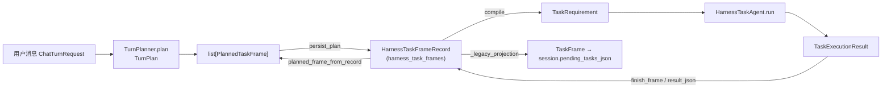
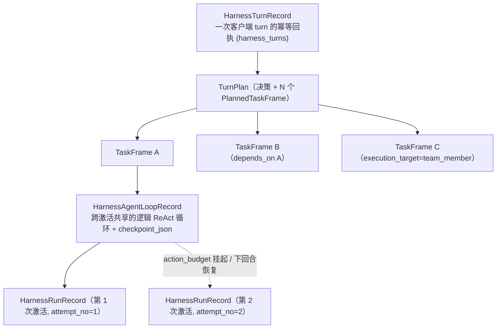
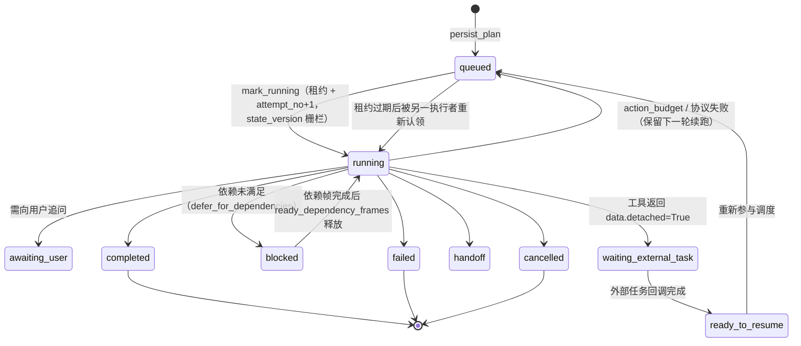

# TaskFrame：Harness v2 的任务帧

> 分析对象：TaskFrame 相关数据结构与持久化层
> 分析日期：2026-09-15
> 主要源码：
> - `backend/app/session/session_schema.py`（`TaskFrame:38`、`PlannedTaskFrame:53`、状态字面量 `:21-34`、`TurnPlan:115`）
> - `backend/app/db/models.py`（`HarnessTaskFrameRecord:1246`、`HarnessAgentLoopRecord:1219`、`HarnessRunRecord:1285`、`HarnessTurnRecord:1313`）
> - `backend/app/core/task_frame_store.py`（`TaskFrameStore`、`planned_frame_from_record:1063`）
> - `backend/app/core/task_request_compiler.py`（`TaskRequirement:56`、`TaskExecutionResult:82`、`compile:110`）
>
> 互补文档：[HarnessV2Engine 代码走读](harness_v2_engine_walkthrough.md)、[harness_agent.py 分析](harness_agent_analysis.md)、[run() 逐句注释](harness_agent_run_annotated.md)

---

## 0. 一句话定义

**TaskFrame（任务帧）是 Harness v2 对「用户一句话里拆出来的一个可独立执行子任务」的抽象，是调度、持久化、跨回合恢复的基本单位。**

一次用户 turn 经 `TurnPlanner` 规划后可拆成最多 8 个 TaskFrame（`MAX_TASK_FRAMES_PER_TURN = 8`），帧之间可有依赖、可派发给团队成员、可跨多个用户回合挂起/恢复。`HarnessTaskAgent` 就是「在单个 TaskFrame 内」跑隔离 ReAct 循环的执行器。

---

## 1. 三种形态（最容易混淆的点）

代码里有三个都叫「TaskFrame」的模型，分别处于不同阶段：

| 形态 | 类型 / 位置 | 阶段 | 性质 |
|---|---|---|---|
| **计划帧** | `PlannedTaskFrame`（`session_schema.py:53`） | 规划器产出 → 落库前 | 内存对象，字段最丰富，含派发目标/激活条件 |
| **持久化行** | `HarnessTaskFrameRecord`（`models.py:1246`，表 `harness_task_frames`） | 落库后 | 运行时权威状态，带租约/版本/尝试次数 |
| **对外投影** | `TaskFrame`（`session_schema.py:38`） | 写给前端/旧契约 | 由 `_legacy_projection` 生成，挂到 `session.pending_tasks_json` |

转换关系：



---

## 2. 分层位置：Turn → TaskFrame → AgentLoop → Run



| 层级 | 表 / 模型 | 粒度 | 关键内容 |
|---|---|---|---|
| Turn | `harness_turns` | 一次客户端请求 | 幂等 claim、请求摘要、终态响应（可重放） |
| **TaskFrame** | `harness_task_frames` | **一个子任务** | 意图/需求/槽位/SOP 节点/依赖/状态/租约 |
| AgentLoop | `harness_agent_loops` | 帧内可恢复循环 | `checkpoint_json`（transcript、引用、证据…） |
| Run | `harness_runs` | 一次激活/尝试 | 当次 `TaskRequirement` 快照、能力清单快照、action_count、结果 |

TaskFrame 的四个核心职责：

1. **执行隔离单元**：编译成自包含 `TaskRequirement`，内层 agent 只看这一帧；兄弟帧意图经 `out_of_scope_task_intents` 显式禁止越界。
2. **可恢复的持久单元**：靠 `lease_owner / lease_expires_at / state_version / attempt_no` 实现租约栅栏与乐观并发，崩溃/跨回合可安全续跑。
3. **依赖与并行调度单元**：`depends_on_json` 构成 DAG；前置未完成则 `blocked`；`team_member` 帧派发给其他成员。
4. **SOP 图载体**：`kind="sop"` 绑定 `skill_id + step_id`，一次激活可沿图推进多节点；`kind="conversation"` 是不挂 SOP 的一次性问答/任务。

当前活动帧指针：`session.context_state_json["harness_v2"]["active_task_frame_id"]`（常量 key `HARNESS_CONTEXT_KEY="harness_v2"`）。

---

## 3. 生命周期与状态机

状态字面量 `TaskFrameRunStatus`（`session_schema.py:23-34`）：

```
queued | running | waiting_external_task | ready_to_resume
       | awaiting_user | blocked | completed | handoff | failed | cancelled
```

终态集合 `TERMINAL_FRAME_STATUSES = {"completed","cancelled","failed"}`（`task_frame_store.py:21`）。



由 `TaskFrameStore` 驱动的关键迁移：

| 方法 | 行号 | 作用 |
|---|---|---|
| `persist_plan` | `:135` | 计划帧 upsert 落库；终态帧跳过、运行中帧校验租约；合并槽位/依赖；`state_version+1` |
| `mark_running` | `:226` | 条件更新 `queued→running`，发放新 `lease_owner`、`attempt_no+1`；竞争失败抛 `TaskFrameClaimConflict` |
| `save_requirement` | `:259` | 保存编译后的 `TaskRequirement` 快照 |
| `renew_running_lease` | `:306` | 执行期间续约（栅栏） |
| `finish_frame` | `:358` | 栅栏化终结（校验 status=running + owner + attempt + 未过期），清空租约 |
| `defer_for_action_budget` | `:523` | 超预算帧推迟 |
| `defer_for_dependencies` / `dependencies_satisfied` / `ready_dependency_frames` | `:684/:655/:706` | DAG 依赖阻塞与释放 |
| `project_session` | `:873` | 把非终态 SOP 帧投影进 `session.pending_tasks_json` |
| `planner_state` | `:905` | 供规划器读取的在途帧视图 |
| `complete_active_frame` | `:973` | 用户主动结束当前任务 |

租约时长 `FRAME_LEASE_SECONDS = 900` 秒（`:27`）；`persist_plan` 遇到 running 且租约已过期会 `_abandon_stale_runs` 后重置为 queued。

---

## 4. 数据结构字段表

### 4.1 持久化行 `HarnessTaskFrameRecord`（表 `harness_task_frames`）

唯一约束：`UniqueConstraint(session_id, task_id, name="uq_harness_task_frame_session_task")`。主键 `id` 形如 `htask_...`。

**标识与归属**

| 字段 | 类型 | 含义 |
|---|---|---|
| `id` | str PK | 行主键 `htask_...` |
| `tenant_id` | str(idx) | 租户 |
| `session_id` | str(idx) | 所属会话 |
| `task_id` | str(idx) | **业务稳定 ID**（规划器给定）；依赖、外部任务都引用它，同会话内唯一 |
| `source_turn_id` | str(idx) | 创建/最近驱动该帧的用户消息 ID |
| `agent_loop_id` | str? (idx) | 关联的持久 AgentLoop |

**分类与状态**

| 字段 | 类型 | 含义 |
|---|---|---|
| `kind` | str(idx) | `sop` / `conversation`（默认 conversation） |
| `decision` | str(idx) | 路由决策（`answer_only/start_new_task/continue_active/switch_to_pending/complete_task/handoff_human/clarify…`） |
| `status` | str(idx) | 状态机中的运行状态（默认 queued） |
| `sequence` | int | 在本轮计划中的执行序号 |

**SOP 绑定**

| 字段 | 类型 | 含义 |
|---|---|---|
| `skill_id` | str? (idx) | 绑定的 SOP；conversation 帧为 null |
| `step_id` | str? (idx) | 当前 SOP 节点，执行推进时更新 |

**任务内容（JSON 列）**

| 字段 | 类型 | 含义 |
|---|---|---|
| `user_intent` | str? | 该帧要完成的意图 |
| `requirements_json` | list[str] | 具体需求条目 |
| `slots_json` | dict | 已收集槽位（落库时合并会话槽位 + 计划 `slot_hints`） |
| `depends_on_json` | list[str] | 前置 `task_id`（仅保留同轮计划内、非自身） |
| `task_requirement_json` | dict | 实际喂给内层 agent 的编译后 `TaskRequirement` 快照 |
| `result_json` | dict | 执行产出的 `TaskExecutionResult` |
| `error_json` | dict | 错误码/信息（如 `SOP_STEP_TIMEOUT`、`ACTION_BUDGET_EXHAUSTED`） |

**并发与耐久**

| 字段 | 类型 | 含义 |
|---|---|---|
| `state_version` | int | 乐观锁版本，认领/终结时做条件更新 |
| `attempt_no` | int | 被认领执行次数（每次 `mark_running` +1） |
| `lease_owner` | str? (idx) | 当前执行租约持有者；终结时清空 |
| `lease_expires_at` | datetime? (idx) | 租约过期时刻；过期可被他人重新认领 |
| `created_at` / `updated_at` | datetime | 时间戳 |

### 4.2 内存计划帧 `PlannedTaskFrame`（`session_schema.py:53`）

| 字段 | 去向 | 含义 |
|---|---|---|
| `task_id` | → `task_id` | 业务稳定 ID |
| `kind` | → `kind` | `sop` / `conversation` |
| `status` | → `status` | 计划态（默认 queued） |
| `decision` | → `decision` | 路由决策（默认 answer_only） |
| `target_skill_id` | → `skill_id` | 目标 SOP |
| `target_step_id` | → `step_id` | 目标节点 |
| `user_intent` | → `user_intent` | 意图 |
| `requirements` | → `requirements_json` | 需求条目 |
| `slot_hints` | → `slots_json` | 槽位提示（与会话槽位合并） |
| `depends_on_task_ids` | → `depends_on_json` | 前置依赖 |
| `execution_target` | （不落帧行） | `self` / `team_member`，团队派发在规划阶段处理 |
| `assignee_agent_id` | （派发用） | 被指派的团队成员 agent |
| `activation_condition` | （调度用） | 激活条件 |
| `source_message` | （溯源用） | 来源用户原话 |

> `PlannedTaskFrame` 带多个 `field_validator`，把 `None` 归一成 `{}` / `[]`，保证下游序列化稳定。
> 一批帧由 `TurnPlan.task_frames: list[PlannedTaskFrame]`（`:128`）承载；`TurnPlan` 的 docstring 明确：**能力选择不属于 TurnPlan**，每帧在持久化后才编译成 Harness 任务。

### 4.3 对外投影 `TaskFrame`（`session_schema.py:38`）

旧契约模型，字段较扁：`task_id / status / skill_id / step_id / slots / intent_summary / source_turn_id / source_message / parent_task_id / resume_policy / created_at / updated_at`。由 `_legacy_projection`（`task_frame_store.py:1099`）从持久化行生成，其中：

- 状态做兼容映射：`queued/blocked/action_budget/ready_to_resume → "pending"`；
- 同时冗余 `target_skill_id/target_step_id/slot_hints/user_intent`；
- 固定 `resume_policy="harness_v2"`；
- 仅投影**非终态、kind=sop、且不是当前活动帧**的帧，并保留不被 v2 托管的旧 `pending_tasks_json` 条目（legacy）。

---

## 5. 字段映射：计划帧 → TaskRequirement → 执行结果

### 5.1 `PlannedTaskFrame` →（`persist_plan`）→ Record

见 §4.2「去向」列。要点：

- `continue_active` 且目标 SOP 正是当前活动技能时，`step_id` 取 `session.active_step_id`，槽位以会话槽位为基底合并（`task_frame_store.py:190-208`）；
- 依赖只保留**同一轮 bounded 计划内**且非自身的 ID（`:209-216`），避免悬挂引用。

### 5.2 Record/Frame →（`TaskRequestCompiler.compile`）→ `TaskRequirement`（`task_request_compiler.py:176-198`）

| TaskRequirement 字段 | 来源 |
|---|---|
| `task_frame_id` | `frame.task_id` |
| `kind` | `frame.kind` |
| `goal` | 由 `_goal(frame, skill, current_node, requirements)` 综合 |
| `current_time` | 调用方时区经 `_current_time_text`（注入"今天日期"，避免模型让 shell 代算） |
| `source_user_message` | 当前驱动用户消息（截断 4000 字符） |
| `out_of_scope_task_intents` | 同消息中被兄弟帧接管的意图 |
| `requirements` | 当前节点 `instruction` + 待补字段 + `frame.requirements`（去重） |
| `sop_context` | `_sop_context(skill, current_node)` |
| `required_slots` / `known_slots` | 节点 `expected_user_info` 与已满足槽位之差；conversation 帧 known_slots 为空 |
| `completion_criteria` | 节点字段要求 + SOP goal + 强制能力/知识库要求 + "完整处理全部子需求" |
| `required_capability_names` / `required_knowledge_base_ids` | `_required_step_capabilities(current_node, manifest)` |
| `allowed_transitions` | `_transitions(skill, current_node)`（图白名单） |
| `memory_projection` | 记忆上下文 |
| `prior_task_results` | 前置帧 + 同会话被槽位引用的能力结果 |
| `attachments` / `published_deliverables` | 物化附件 / 已发布交付物 |
| `capability_manifest` | 冻结能力清单（模型只看到安全投影，服务端保留完整清单授权） |

### 5.3 `HarnessTaskAgent.run` → `TaskExecutionResult` →（`finish_frame`）→ Record

`TaskExecutionResult`（`task_request_compiler.py:82-104`）字段去向：

| TaskExecutionResult | 含义 | 写回 |
|---|---|---|
| `status` | completed/awaiting_user/handoff/waiting_external_task/failed/blocked/action_budget | `finish_frame(status=...)` → `record.status`（action_budget/可恢复协议失败会被改成 queued） |
| `reply_fragment` | 对用户的片段 | 并入 `result_json`，最终参与回复合成 |
| `slot_updates` | 本帧收集槽位 | 经 `_apply_step_result` 进会话，再回写 `record.slots_json` |
| `next_step_id` | 请求的图跳转（已过白名单） | 驱动 SOP 推进 → `record.step_id` |
| `citations / evidence_results / artifacts` | 引用/证据/产物 | `result_json`；artifacts 并入 checkpoint |
| `capability_results` | 能力调用结果 | `result_json` |
| `task_summary` | 面向 planner 的摘要 | `result_json` |
| `action_count` | 消耗动作数 | `finish_run.action_count`，并扣减帧预算 |
| `error` | `{code,message}` | `record.error_json` |
| `structured_result` | 业务结构化结果/外部任务信息 | `result_json` |
| `loop_checkpoint`（`exclude=True`，不对外序列化） | 帧/步骤两级恢复点 | 单独存到 `HarnessAgentLoopRecord.checkpoint_json`，**不**进帧行 |

> 注意分工：**业务结果**进帧的 `result_json`；**可恢复循环状态**（transcript、引用、证据、已满足知识库等）进 AgentLoop 的 `checkpoint_json`。这正是 `run()` 内 `finish()` 闭包写 `loop_checkpoint`、引擎再分别落两张表的原因。

---

## 6. 关联表速览

| 表 | 模型:行 | 唯一约束 | 一句话 |
|---|---|---|---|
| `harness_task_frames` | `HarnessTaskFrameRecord:1246` | `(session_id, task_id)` | TaskFrame 权威持久状态 |
| `harness_agent_loops` | `HarnessAgentLoopRecord:1219` | `(session_id, loop_key)` | 帧内可跨激活复用的循环 + checkpoint |
| `harness_runs` | `HarnessRunRecord:1285` | — | 一次激活尝试：需求/能力快照、动作数、结果、租约 |
| `harness_turns` | `HarnessTurnRecord:1313` | `(tenant_id, session_id, client_turn_id)` | turn 幂等回执，精确一次 + 重放 |

四者通过 `task_id / task_frame_record_id / agent_loop_id / source_turn_id / session_id` 互相串联，配合会话锁、会话租约、帧租约（fencing）与 turn 回执，构成「同会话串行、跨进程互斥、失败可恢复、重试不重复」的执行保证。

---

## 7. 小结

- **TaskFrame = 一次规划拆出的一个可执行、可持久化、可恢复的子任务**，是 Harness v2 的调度中枢。
- 三个同名类型按阶段区分：`PlannedTaskFrame`（计划）→ `HarnessTaskFrameRecord`（权威状态）→ `TaskFrame`（对外投影）。
- 它向上承接 `TurnPlan`，向下编译为自包含 `TaskRequirement` 交给 `HarnessTaskAgent`，结果回写帧行、循环检查点写入 AgentLoop，一次激活对应一条 Run。
- 靠 `status` 状态机 + `state_version` 乐观锁 + `lease_*` 租约栅栏 + `attempt_no` + DAG 依赖，实现多帧调度、团队派发、外部任务挂起、跨回合安全续跑。
