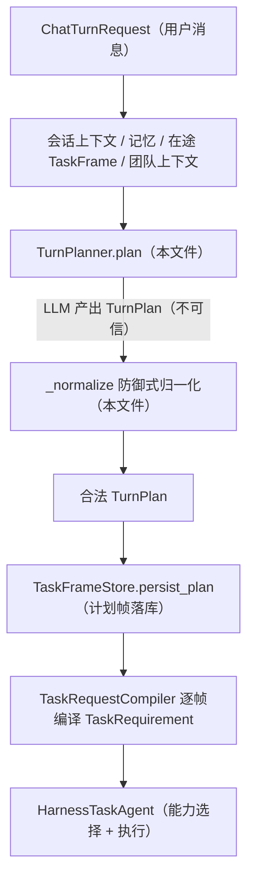
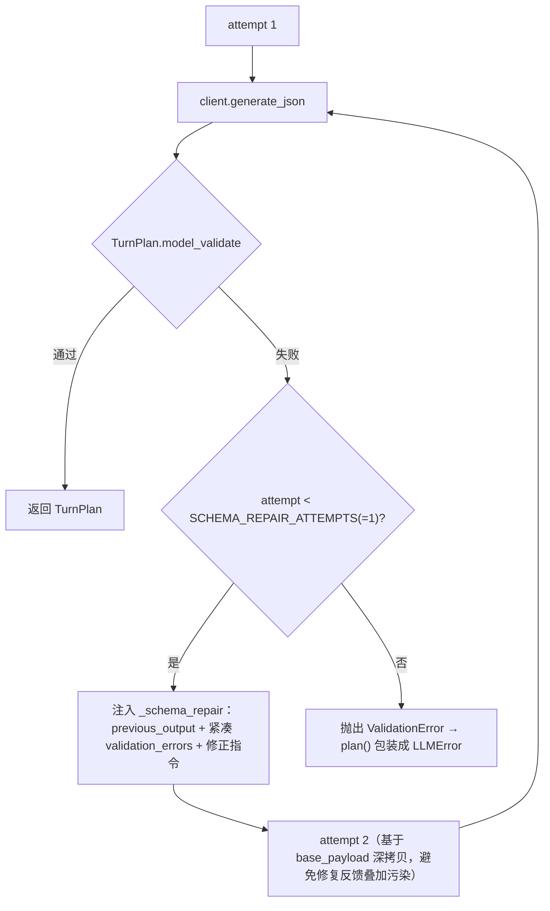
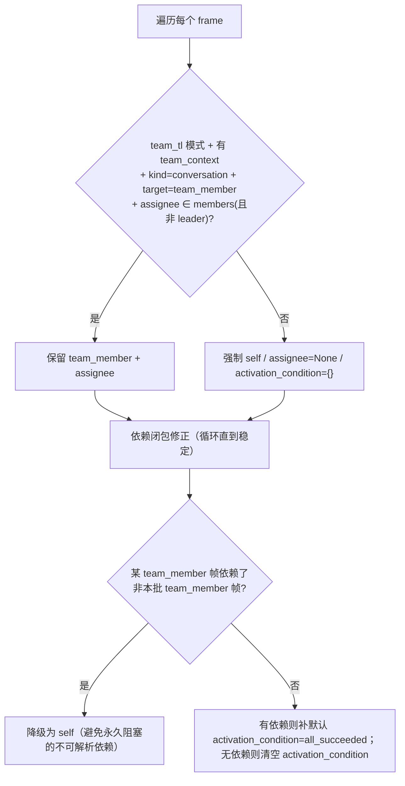
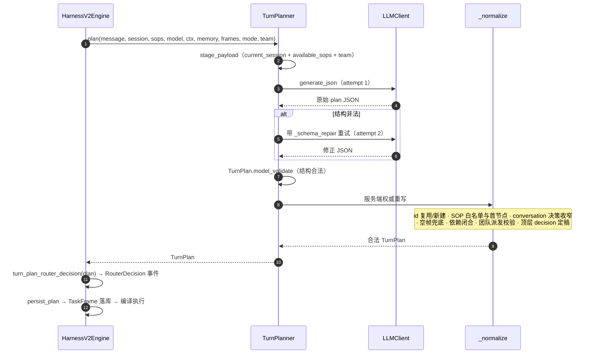

# `turn_planner.py` 分析：Harness v2 的意图与任务拆分规划器

> 分析对象：`backend/app/core/turn_planner.py`（647 行）
> 分析日期：2026-09-15
> 核心类型：`TurnPlanner`（`:41`）、模块函数 `turn_plan_router_decision`（`:448`）
> 系统提示词：`backend/app/llm/prompts/turn_planner_prompt.md`（60 行，`PROMPT_PATH :35`）
> 输出契约：`TURN_PLANNER_OUTPUT_SCHEMA`（`app/llm/stage_protocol.py:66`）
> 互补文档：[HarnessV2Engine 代码走读](harness_v2_engine_walkthrough.md)、[TaskFrame 分析](task_frame_analysis.md)、[harness_agent.py 分析](harness_agent_analysis.md)

---

## 0. 一句话结论

`TurnPlanner` 是 Harness v2 流水线中**唯一负责「意图判定 + SOP 路由 + 本轮任务拆分」的 LLM 阶段**。它把「用户一句话 + 会话/SOP/在途任务/团队上下文」变成一个结构化的 `TurnPlan`（一个路由决策 `decision` + 本轮要执行的 `PlannedTaskFrame` 列表 + 对既有任务的 `TaskUpdate`）。

它**只做规划、不做执行**：不选 GeneralSkill、不选知识库或工具、不生成工具调用、不读 SOP 节点图细节、不生成最终回复。模型产出的计划是「半成品」，真正的权威决策由 `_normalize()` 用服务端状态（技能白名单、在途帧、图首节点、团队目录、依赖闭包）做一次**防御式重写**后才落地——模型负责「理解意图」，服务端负责「决定什么合法」。

---

## 1. 定位：在 Harness v2 流水线中的位置



调用点：`HarnessV2Engine.run()`（`harness_v2_engine.py:349`）。注意斜杠指令（`/skill`、`/tool`）走的是 `build_slash_turn_plan`，**不经过** `TurnPlanner`（`harness_v2_engine.py:332-347`）。

类 docstring 原文（`:42`）：

> "Single scene/SOP intent planner for the Harness v2 execution path."

### 1.1 职责边界（来自提示词与代码）

| 它做 | 它不做 |
|---|---|
| 判定继续/切换/开始/完成/不推进某 SOP | 不选 GeneralSkill / 知识库 / Tool |
| 把本轮工作拆成有序 `PlannedTaskFrame` | 不生成工具调用、不生成最终回复 |
| 保留同句附加需求到 frame.requirements | 不读 SOP 节点图（起始/当前节点由服务端定） |
| 产出对既有任务的 `task_updates` | 不决定能力可见性（后续帧内 agent 自治） |
| 团队 TL 模式下拆成员任务并指派 | 不编造团队成员（只接受 `team_context` 目录内的 id） |

---

## 2. `plan()`：入参与 Payload 组装（`:44-99`）

### 2.1 入参

| 参数 | 含义 |
|---|---|
| `message` | 用户本轮原话（规划意图的事实源） |
| `session` | 当前会话（active_skill/step、slots、pending_tasks、status） |
| `available_skills` | 当前可见的 SOP（`Skill` 是 SOP 的历史模型名） |
| `model_config` | 规划所用模型 |
| `conversation_context` | 压缩后的会话历史上下文 |
| `memory_context` | 记忆事实/偏好 |
| `task_frame_state` | 在途 TaskFrame 视图（`TaskFrameStore.planner_state`） |
| `interaction_mode` | 默认 `normal`；`team_tl` 时启用团队派发 |
| `team_context` | `TeamPlannerContext`（team_id / leader_agent_id / members） |

### 2.2 LLM payload（`:56-78`）

通过 `stage_payload(phase="TurnPlanner", ...)` 组装，`stage_data` 含三块：

- `current_session`：`_session_payload()`（`:581`）——active skill/step、slots、压缩后的 pending_tasks / awaiting_input、**在途 task_frames**、会话 status；空字段经 `_without_empty` 剔除。
- `available_sops`：`_sop_payload()`（`:599`）——仅 `skill_id / name / description / trigger_intents`。注释强调：**刻意不把 GeneralSkill 放进 TurnPlanner**，避免它把运行时能力与 SOP 路由候选混淆。
- `interaction_mode` + `team_context`：团队模式下注入唯一可信团队目录。
- 输出契约：`TURN_PLANNER_OUTPUT_SCHEMA`（见 §6）。

### 2.3 调用与异常归一（`:79-90`）

- `LLMClient(model_config)` + `llm_operation("turn_planner.plan")` span 内调用 `_generate_validated_plan`。
- 异常归一：`LLMError` 原样上抛；其他一切异常（含 JSON/Schema 校验失败、解析异常）包装成 `LLMError("Turn Planner returned invalid JSON schema: ...")`。这样上层只需按 `LLMError` 一类处理规划阶段故障。

### 2.4 成功后

`:91-99` 调用 `_normalize(...)` 做服务端重写并返回合法 `TurnPlan`。

---

## 3. `_generate_validated_plan()`：Schema 校验与一次修复（`:101-134`）



要点：

- `SCHEMA_REPAIR_ATTEMPTS = 1`（`:38`）：最多 2 次尝试（首次 + 1 次修复）。
- 每次尝试用 `llm_span_attributes(schema_attempt/schema_retry_count/schema_max_attempts)` 记录可观测属性。
- 修复 payload 从 `base_payload`（原始入参）深拷贝，再挂 `_schema_repair`，避免上一次失败输出/反馈污染基础上下文。
- 修复指令明确：「合法 JSON 但字段类型不对；保留任务语义、只修字段；空 object 用 `{}`、空 array 用 `[]`，容器字段不要 null」。
- `_compact_validation_errors`（`:375`）把 pydantic 错误压成 `{path,type,message}` 列表（去掉 url/input），减小回灌体积。
- 循环理论上必返回或抛出，末尾 `raise AssertionError("unreachable")` 是静态完备性兜底。

> 这里校验的是**结构合法**（字段类型/字面量），不是**业务合法**。业务合法性全部在 `_normalize` 判定。

---

## 4. `_normalize()`：服务端权威重写（`:136-372`，本文件核心）

模型输出不可直接信任。这个方法把每个计划帧对照服务端真实状态重写一遍。可分为 7 步。

### 4.1 准备索引（`:146-150`）

- `skills = {skill_id: Skill}`：可用 SOP 白名单。
- `known_frames = _known_task_frames(session, task_frame_state)`（`:515`）：合并「在途帧视图 + 会话 pending_tasks_json」，按 `task_id` 建索引，并补齐 `kind/skill_id/step_id/requirements` 的兼容默认值。
- `frames / seen_ids / task_id_map`：重写后的帧、去重 id 集合、「模型写的旧 id → 服务端实际 id」映射。

### 4.2 逐帧重写（`:151-221`，截断到 `MAX_TASK_FRAMES_PER_TURN=8`）

对每个模型帧深拷贝后：

**(a) task_id 复用 vs 新建（`:153-167`）**

- 若模型给的 id 命中一个**非终态**在途帧（status 不在 completed/cancelled/failed）→ 复用该 id，并以在途帧的 `kind` 为准（继续既有任务）。
- 否则 → `_unique_task_id(None, seen)` 生成全新 `task_...` id（防止模型伪造/复用终态 id）。
- 同时记录 `task_id_map[模型原id] = 实际id`，供后面依赖重定向。

**(b) SOP 帧校验与决策修正（`:168-194`）**

- 若 `kind=sop` 且命中在途帧：用在途帧的 `skill_id/step_id` 覆盖模型值（服务端状态优先）；`decision` 归一为 `switch_to_pending`（模型若如此声明）否则 `continue_active`。
- `target_skill_id` 缺失或**不在白名单** `skills` → 直接 `continue` **丢弃该帧**（不允许路由到不可见/不存在的 SOP）。
- 新 SOP 帧：
  - `continue_active` 且目标正是当前 active skill → step 取 `session.active_step_id`，缺省回退图首节点；
  - 其他情况 → `decision` 强制为 `start_new_task`，step 强制为图首节点 `_first_node_id`（`:490`：优先 `start_node_id`，否则 nodes 数组首个）。**模型无权跳步**。

**(c) conversation 帧归一（`:195-202`）**

- 清空 skill/step；`decision` 仅允许 `handoff_human`（仅当顶层 plan 也是 handoff）、`clarify`，其余一律 `answer_only`。

**(d) 去重 id、槽位清洗、requirements 合并（`:203-220`）**

- 再次保证 `task_id` 在本批唯一。
- `slot_hints` 经 `strip_router_generated_message_slots` 清洗（禁止把用户原话塞进 message_content 槽）。
- `requirements` = 去重合并「在途帧既有 requirements + 本帧新 requirements」，再经 `_requirements()`（`:621`）保证非空、单行、缺省回退「完成用户本轮请求。」。
- `user_intent` 压成单行（缺省取首个 requirement），写入 `source_message = message`（无视模型是否输出该字段——提示词也要求它不要输出）。

### 4.3 模型一帧都没给时的三选一兜底（`:223-337`）

规划器有时不返回任何帧（例如只给了顶层 decision）。服务端按顶层 `plan.decision` 兜底：

| 顶层 decision | 条件 | 兜底帧 |
|---|---|---|
| `continue_active` | 存在 active SOP | 一个 `sop / continue_active` 帧，复用 active 在途帧 id（若有），step 用当前节点 |
| `handoff_human` | active SOP 且 BFS 能找到可达 handoff 节点 | 一个 `sop / handoff_human` 帧，step 指向 `_find_handoff_node_id`（`:503`，基于 edges 的 BFS） |
| `handoff_human` | 找不到 handoff 节点 | 退化为一个 `conversation / handoff_human` 帧（复用 active 对话帧 id） |
| 其他（含 clarify/answer_only） | — | 一个 conversation 帧，decision 为 `clarify` 或 `answer_only`，复用 active 对话帧 id |

> 这保证「没有 SOP 也至少有一个 conversation 帧」（与提示词约束一致），下游调度永远拿到非空执行队列。

### 4.4 依赖闭合重写（`:339-346`）

```python
frame.depends_on_task_ids = [
    task_id_map.get(tid, tid) for tid in 去重(原依赖)
    if 重定向后 id ∈ 本批合法 id 集合 and  != 自身
]
```

- 把模型写的依赖 id 重映射到服务端实际 id；
- **剔除指向不存在任务、或指向自身**的依赖，避免产生永久阻塞/自环帧。

### 4.5 团队派发目标校验（`:347-351` → `_normalize_execution_targets`，见 §5）

### 4.6 顶层 decision/selected_task_id 定稿（`:353-368`）

以重写后的**第一帧**为准，反向修正顶层决策：

- `complete_task`：`selected_task_id` 仅当它确实在 `known_frames` 中才保留，否则置空。
- 第一帧是 SOP：顶层 `decision = first.decision`；仅当 `switch_to_pending` 时设 `selected_task_id = first.task_id`。
- 第一帧非 SOP：除 `clarify/handoff_human/complete_task` 外，统一归为 `answer_only` 并清空 selected_task_id。

### 4.7 收尾（`:369-372`）

- `plan.task_frames = frames`（用服务端重写结果替换模型原帧）；
- `plan.task_updates = _sanitize_task_updates(...)`（见下）；
- `user_intent` 单行化（缺省取第一帧意图，再缺省取原话）。

`_sanitize_task_updates`（`:555`）对模型的任务更新做白名单：仅保留**引用了在途 id、去重后**的更新；`status` 只接受字符串 `"queued"`（不允许模型直接写 running/completed/failed）；不允许借此改 skill/step；槽位同样清洗；`remove` 转布尔。

---

## 5. `_normalize_execution_targets()`：团队派发安全校验（`:389-445`）

原则（docstring）："Validate planner-selected assignees without guessing team membership."（只校验、不臆测团队成员。）



三个关键约束：

1. **合法远程派发的 5 个条件**（`:404-410`）：必须是 `team_tl` 模式、有团队上下文、帧是 `conversation`、`execution_target=team_member`、assignee 在成员目录且不是 leader。任一不满足强制回落 `self`。
2. **远程帧只能依赖本批其他远程帧**（`:419-438`）：用 `while True` 迭代到不动点——一旦某远程帧依赖了 leader 本地帧（id 不在 `remote_ids`），就降级为 self（降级可能产生新的连锁，故需循环）。注释说明：否则会制造一个依赖永远无法满足、永久 blocked 的任务。
3. **激活条件**（`:440-444`）：远程帧若有依赖，缺省补 `{"type":"all_succeeded"}`；无依赖则清空。

> 团队成员帧刻意使用 `kind=conversation`：成员在自己的运行环境里会**重新匹配**自己的 SOP/技能/工具，TL 不替成员决定执行路径（见提示词 team_tl 段）。

---

## 6. 输入/输出数据契约

### 6.1 输出 Schema（`stage_protocol.py:66-100`，提示给模型的形状）

顶层：`decision`（7 选 1 路由决策）、`selected_task_id?`、`confidence`、`user_intent?`、`reason?`、`clarification_question?`、`task_frames[]`、`task_updates[]`。

帧字段：`task_id? / kind(sop|conversation) / decision / target_skill_id? / target_step_id? / user_intent? / requirements[] / slot_hints{} / depends_on_task_ids[] / execution_target(self|team_member) / assignee_agent_id? / activation_condition{}`。

### 6.2 落地类型 `TurnPlan`（`session_schema.py:115`）

- `decision: RouterDecisionValue`（`continue_active/switch_to_pending/create_pending/update_pending/complete_task/start_new_task/answer_only/handoff_human/clarify`）
- `selected_task_id / confidence / user_intent / reason / clarification_question`
- `task_frames: list[PlannedTaskFrame]`（结构见 [TaskFrame 分析](task_frame_analysis.md) §4.2）
- `task_updates: list[TaskUpdate]`
- docstring 明确：**能力选择不属于本契约**，每帧持久化后才编译成 Harness 任务。

### 6.3 投影：`turn_plan_router_decision()`（`:448-487`）

把 `TurnPlan` 转成对外/事件用的 `RouterDecision`：

- 从帧中筛出 **SOP 帧**生成 `PendingTask` 列表（conversation 帧不进 pending_tasks）；
- `decision`：优先取第一个 SOP 帧的 decision；否则仅保留 `answer_only/clarify/handoff_human/complete_task`，其他归 `answer_only`；
- target skill/step、slot_hints 取首帧；透传 confidence/reason/clarification_question/task_updates。

引擎在规划后会同时记录 `turn_plan_created`（完整 plan）与 `router_decision_created`（该投影）两个事件（`harness_v2_engine.py:412-432`），保留旧公开 trace 兼容。

---

## 7. 辅助函数速查

| 函数 | 行号 | 职责 |
|---|---|---|
| `_compact_validation_errors` | `:375` | pydantic 错误压缩为 `{path,type,message}` |
| `_normalize_execution_targets` | `:389` | 团队派发合法性校验 + 依赖闭包降级 + 激活条件补全 |
| `turn_plan_router_decision` | `:448` | TurnPlan → 对外 RouterDecision 投影 |
| `_first_node_id` | `:490` | 取 SOP 图首节点（start_node_id 或 nodes[0]） |
| `_find_handoff_node_id` | `:503` | 委托 `GraphRules.find_handoff_node_id` 做基于 edges 的 BFS，找当前节点可达的 handoff 节点 |
| `_known_task_frames` | `:515` | 合并在途帧视图 + 会话 pending_tasks，按 task_id 索引并补默认值 |
| `_sanitize_task_updates` | `:555` | task_updates 白名单：在途 id、去重、禁止写执行态/改图 |
| `_session_payload` | `:581` | 组装给模型的 current_session（压缩 + 去空） |
| `_sop_payload` | `:599` | SOP 路由候选精简投影（id/name/description/trigger_intents） |
| `_unique_task_id` | `:611` | 复用合法 id 或生成不冲突的 `task_...` |
| `_requirements` | `:621` | requirements 去重 + 非空兜底 |
| `_unique_text` | `:629` | 字符串列表单行化去重 |
| `_one_line` | `:638` | 折叠空白为单行 |
| `_without_empty` | `:642` | 剔除值为 None/""/[]/{} 的键 |

---

## 8. 端到端流程图



---

## 9. 设计要点小结

1. **单一规划阶段**：意图判定、SOP 路由、本轮任务拆分集中在一个 LLM 阶段；能力选择下沉到帧内 agent，规划与执行彻底解耦（提示词多次强调边界）。
2. **模型出意图、服务端出裁决**：`_normalize` 不信任模型的任何 id/skill/step/decision/assignee——技能必须在白名单、起始/当前节点由图状态决定、task_id 必须是在途非终态或服务端新生成、团队 assignee 必须在目录内、依赖必须闭包到本批合法帧。
3. **结构错误可修复、业务错误直接纠正**：JSON Schema 不符给一次 `_schema_repair`；业务上不合法的帧不是报错，而是被丢弃、降级或重写（如 SOP 不在白名单则丢帧、远程帧依赖本地帧则降级 self），保证下游永远收到可执行计划。
4. **永不空转**：模型不给帧也按顶层 decision 兜底出至少一个 conversation 帧；requirements 必有非空回退。
5. **团队派发零臆测**：只接受 `team_context.members` 中的精确 agent_id，远程任务只能依赖本批远程任务，杜绝伪造成员与永久阻塞依赖。
6. **可观测与兼容**：规划 span 带 schema 重试属性；同时产出完整 `turn_plan_created` 与旧版 `router_decision_created`；非 LLM 异常统一包装为 `LLMError` 供上层单通道处理。
